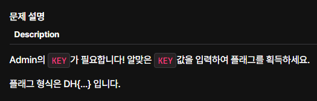
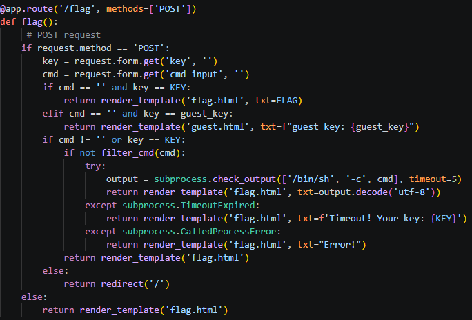

# [문제 설명]

# 목표
문제를 통해 플래그 획득

# 코드 분석

사용자가 입력한 `key`의 값이 올바르지 않으면 다음 조건문으로 실행 흐름이 이어진다.
세 번째 조건문에서는 `cmd_input`으로 전달받은 명령어를 실행한다. 
이때 `output = subprocess.check_output(['/bin/sh', '-c', cmd], timeout=5)`
타임아웃 매개변수(timeout=5)는 명령이 완료되기를 기다리는 제한시간을 지정한다.
명령 실행이 지정된 제한 시간 내에 완료되지 않으면 `subprocess.TimeoutExpired 예외`가 발생할 수 있다.
이 문제에서는 해당 예외 처리하는 `except` 블록에서 `KEY` 값을 템플릿에 전달하므로, 예외 처리 로직이 이 문제의 핵심이다.

# 익스플로잇
