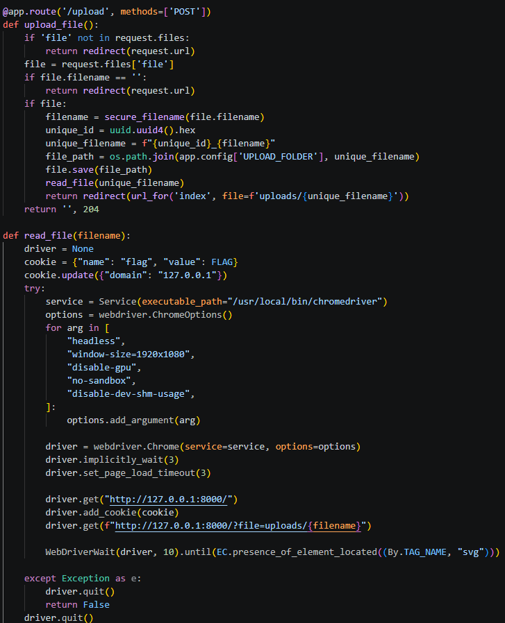
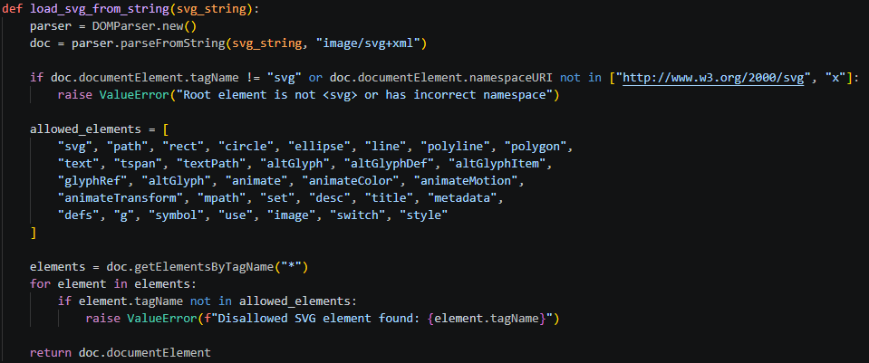

# 문제 설명

# 목표
문제를 통해 플래그 획득

# 공격 표면 분석

`/upload` 경로는 POST 요청을 통해 파일 업로드를 처리한다.
`/upload` 가 `read_file` 함수를 호출하면 관리자 봇이 해당 SVG를 페이지에 렌더링(로드)한다
이 때 관리자 봇의 쿠키(Flag)를 탈취하면 된다.

SVG 요소의 이름만 검사를 한다. 따라서 `allowed_elements`리스트 안의 값으로 쿠키를 탈취한다.

# 익스플로잇
